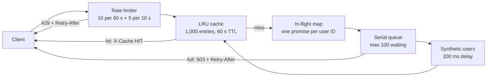

# User Lookup API with LRU Cache, Request Dedup and Rate Limiting (take-home)

A backend take-home exercise: a small Express 5 / TypeScript API that serves user records through an in-memory LRU cache with a TTL, shares concurrent lookups for the same user, funnels cache misses through a bounded serial queue, and throttles each client with a token bucket plus a burst window.

The "database" is three synthetic users in `src/data/mockUsers.ts`, and a 200 ms timer stands in for lookup latency. Nothing external is needed to run it: no database, no API keys, no `.env` file.

## How a request flows



- **Cache** (`src/dal/cache.dal.ts`): a `Map` plus a doubly linked list, so reads and writes are O(1). `get()` promotes the entry; when full, the least recently *read or written* entry is evicted. Entries expire at exactly the TTL (60 s by default), and a hit does not extend it. A 10 s sweep removes expired entries without keeping the process alive.
- **Request deduplication** (`src/dal/requestDeduplicator.dal.ts`): concurrent misses for the same ID share one promise, and the entry is removed whether the lookup resolves or rejects, so a failed lookup is retried next time. If `DELETE /cache` runs while a lookup is in flight, that lookup's result is not written back into the cleared cache.
- **Queue** (`src/dal/queue.dal.ts`): misses for different IDs are processed one at a time. It keeps the event loop free while waiting, but it is not parallel and not durable. At most 100 lookups can wait; past that the API answers 503 rather than letting memory grow.
- **Rate limiter** (`src/middleware/rateLimiter.ts`): see [Rate limiting](#rate-limiting).

## Running it

Requires Node.js 22 (`.nvmrc`) and pnpm 12, which Corepack installs from the `packageManager` field:

```sh
corepack enable
pnpm install --frozen-lockfile
pnpm build
pnpm start          # http://127.0.0.1:3001
```

`pnpm dev` runs the TypeScript source with reload instead of building.

Or with Docker (the image runs as the unprivileged `node` user and has a health check):

```sh
docker build -t user-lookup-api .
docker run --rm -p 3001:3001 user-lookup-api
```

All settings are optional; `.env.example` lists them with their defaults:

| Variable | Default | Purpose |
| --- | --- | --- |
| `PORT` | `3001` | Listening port |
| `HOST` | `127.0.0.1` (`0.0.0.0` in the image) | Bind address |
| `FRONTEND_ORIGIN` | `http://localhost:3000` | The one origin allowed by CORS |
| `TRUST_PROXY` | `false` | Express `trust proxy`: a hop count (`1`) or address list (`loopback`, `10.0.0.0/8`). Set it only behind a real reverse proxy |

There is no authentication on any route, including cache clearing and user creation, so keep it on a private network.

## API

| Method | Route | Response |
| --- | --- | --- |
| GET | `/health` | `200 {"status":"ok"}`, not rate limited |
| GET | `/users/:id` | `200` user, `400` if the ID is not a positive whole number, `404` if unknown, `503` if the queue is full |
| POST | `/users` | `201` user created from JSON `{ "name", "email" }`; `400` on invalid input, `413` over 16 KB, `503` once 10,000 users exist |
| GET | `/cache/status` | Hits, misses, size and the average duration of recent cache fills (ms) |
| DELETE | `/cache` | Empties the cache and resets its statistics |

Errors are always JSON with an `error` field, including malformed JSON bodies and unknown routes.

### Example session

Captured from the Docker image with `curl -i` (date, connection and CORS headers trimmed). Two reads of the same user show the cache miss and then the hit:

```http
GET /users/1

HTTP/1.1 200 OK
RateLimit-Policy: 10;w=60, 5;w=10
RateLimit-Limit: 5
RateLimit-Remaining: 4
X-Cache: MISS
Content-Type: application/json; charset=utf-8

{"id":1,"name":"John Doe","email":"john@example.com"}
```

```http
GET /users/1

HTTP/1.1 200 OK
RateLimit-Policy: 10;w=60, 5;w=10
RateLimit-Limit: 5
RateLimit-Remaining: 3
X-Cache: HIT
Content-Type: application/json; charset=utf-8

{"id":1,"name":"John Doe","email":"john@example.com"}
```

Validation, then the cache statistics (`averageResponseTime` is the 200 ms simulated delay plus overhead):

```http
GET /users/abc

HTTP/1.1 400 Bad Request
RateLimit-Remaining: 2

{"error":"Invalid user ID","message":"User ID must be a positive whole number"}
```

```http
GET /cache/status

HTTP/1.1 200 OK
RateLimit-Remaining: 1

{"hits":1,"misses":1,"size":1,"averageResponseTime":208}
```

The fifth request inside ten seconds still succeeds; the sixth is refused:

```http
GET /users/2

HTTP/1.1 200 OK
RateLimit-Remaining: 0
X-Cache: MISS

{"id":2,"name":"Jane Smith","email":"jane@example.com"}
```

```http
GET /users/3

HTTP/1.1 429 Too Many Requests
RateLimit-Policy: 10;w=60, 5;w=10
RateLimit-Limit: 5
RateLimit-Remaining: 0
Retry-After: 10

{"error":"Rate limit exceeded","retryAfter":10}
```

Eleven seconds later the burst window has reset:

```http
POST /users
Content-Type: application/json

{"name":"Grace Hopper","email":"grace@example.com"}

HTTP/1.1 201 Created
RateLimit-Remaining: 4

{"id":4,"name":"Grace Hopper","email":"grace@example.com"}
```

```http
GET /users/99

HTTP/1.1 404 Not Found
RateLimit-Remaining: 3

{"error":"User not found","message":"User with ID 99 not found"}
```

## Rate limiting

Every accepted request spends from two allowances per client, and both must have room:

- a **token bucket** of 10 that refills one token every 6 s (10 per minute sustained), and
- a **fixed burst window** of 5 requests per 10 s, starting at the first request after the previous window ended.

So this is a ten-per-minute budget with a five-request burst cap, not a sliding window. `RateLimit-Policy` describes both, `RateLimit-Limit`/`RateLimit-Remaining` report the tighter of the two, and a `429` carries `Retry-After` with the longer of the two waits. Browsers on `FRONTEND_ORIGIN` can read these headers and `X-Cache` through CORS.

**Which client is which.** The key is `req.ip`. With `TRUST_PROXY` unset Express ignores `X-Forwarded-For`, so a caller cannot dodge the limit by rotating that header. The flip side: behind a reverse proxy, or when Docker publishes the port, every caller arrives from the same address and shares one bucket. Set `TRUST_PROXY` to the number of proxy hops (or the proxy's address) in that case, and never to `true` on a port clients reach directly.

**Memory.** A bucket idle for 60 s is back to full, so it is dropped then. Buckets are kept in last-use order, so pruning only touches idle ones. At most 10,000 clients are tracked; new clients beyond that get a `429` with `Retry-After: 60` until older ones go idle.

## Tests and checks

```sh
pnpm test        # 19 node:test cases across 7 files, run with tsx
pnpm typecheck   # tsc over src and tests
pnpm lint        # ESLint 10 flat config with typescript-eslint
pnpm build
```

The tests use `node:test` mock timers and an injectable clock rather than real waiting. They cover TTL expiry one millisecond either side of the boundary, LRU promotion on `get()`, deduplicated lookups and recovery after a rejected one, the clear-during-lookup race, the queue and user-store bounds, Retry-After arithmetic, bucket pruning, `X-Forwarded-For` with and without `TRUST_PROXY`, the JSON 400/404/413 error paths, and the cache and rate-limit headers over real HTTP.

## Limits

This was scoped as an exercise, and it stays one:

- Everything is process-local and in memory. A restart loses created users, cache contents, queued work and rate-limit state, and running more than one instance would give each its own cache and limits.
- Queued lookups cannot be cancelled. `averageResponseTime` measures recent cache fills, not all HTTP requests, and each concurrent caller that shares a lookup still counts as a miss.
- There is no authentication, no email uniqueness check, and no load testing; the 200 ms delay is simulated, not measured.

## License

MIT, see [LICENSE](LICENSE).
