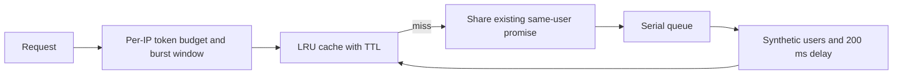

# User lookup and cache exercise

An Express/TypeScript API demonstrating an in-memory LRU cache, concurrent-request sharing, a serial processing queue, and per-IP throttling. The “database” is three synthetic users in `src/data/mockUsers.ts`; a 200 ms timer simulates lookup work. No database or external service is required.

## Why the pieces are separate



The cache uses a map plus a linked list for recency updates and eviction. Its default capacity is 1,000 entries and TTL is 60 seconds. A hit changes recency but does not extend expiry. Lazy reads expire at the exact TTL; a ten-second maintenance timer removes stale entries without keeping an otherwise idle process alive.

Concurrent misses for the same user share one promise. Distinct users wait in a single serial queue: it avoids blocking the event loop while waiting, but it is not parallel work or a durable background-job system. Restarting the server loses users created during the session, cache contents, pending work, and rate-limit state.

## Run and check

Use Node.js 22 and pnpm 9:

```sh
pnpm install --frozen-lockfile --ignore-scripts
pnpm dev
# Or:
pnpm build
pnpm start
```

The API binds to `127.0.0.1:3001`. `PORT` overrides the port and `FRONTEND_ORIGIN` overrides the permitted browser origin (default `http://localhost:3000`). There are no private keys or required environment files. Keep this local: cache management and user creation have no authentication.

```sh
pnpm test
pnpm build
pnpm lint
```

Four Node test groups pass: exact cache expiry/LRU eviction, concurrent same-user deduplication and recovery after a failed lookup, real local HTTP validation/cache hits, and clock-controlled throttling including spoofed forwarding headers. TypeScript compilation and ESLint pass. No external database, provider, or benchmark service was used. The 200 ms lookup delay is a simulation, not a measured production performance claim.

## HTTP contract

| Method | Route | Result |
| --- | --- | --- |
| GET | `/health` | `{ "status": "ok" }`, outside the limiter |
| GET | `/users/:id` | Synthetic/current-session user; positive whole ID required |
| POST | `/users` | Create in-memory user from bounded `name` and `email`; 201 |
| GET | `/cache/status` | Hits, misses, size, and average stored miss duration |
| DELETE | `/cache` | Clear entries and statistics |

Example lookup: `GET /users/1` returns:

```json
{"id":1,"name":"John Doe","email":"john@example.com"}
```

`averageResponseTime` measures recent completed cache-fill/queue durations, not all HTTP requests or hits. Concurrent callers can each count as misses while still sharing one underlying queue request. A clear request does not cancel already queued work, which can subsequently repopulate the cache.

## Rate-limit semantics

Accepted requests debit both a ten-token bucket (refilling one token every six seconds) and a five-request fixed ten-second burst window. This is a sustained ten-per-minute token budget with an initial allowance, **not** a strict rolling ten-request minute or sliding burst window. Responses include `Retry-After` seconds and JSON `retryAfter`.

Client-supplied `X-Forwarded-For` no longer selects a bucket: Express's untrusted-proxy default uses the connection IP. A real reverse proxy needs an explicit trusted-proxy design before deployment. Idle IP buckets expire after five minutes and the map is capped at 10,000 identities. All user/cache routes share the limiter; a UI should refresh cache statistics deliberately rather than poll continuously and consume the same allowance.

## Remaining engineering limits

The queue and created-user store are unbounded, work is process-local, queued requests cannot be cancelled, and cache clear has no in-flight generation barrier. There is no persistence, distributed consistency, email uniqueness check, credential system, or load test. Add resource limits and access rules before exposing writes; use measured concurrency to decide whether an external queue/cache would help. This is an API exercise, so the diagram, contract, and tests explain it more directly than a fabricated dashboard screenshot.
